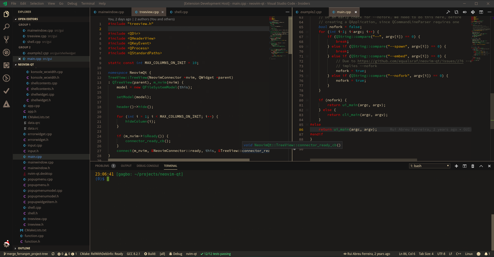
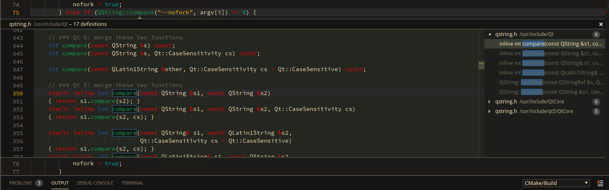
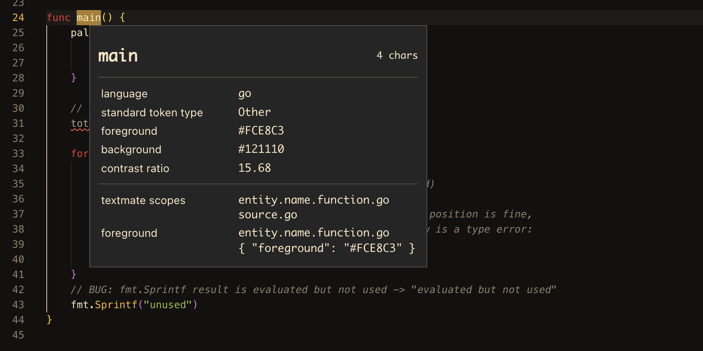

Srcery theme for Visual Studio Code, based on
[srcery-colors/srcery-vim](https://github.com/srcery-colors/srcery-vim)

## Install

### Microsoft Marketplace

Install [Srcery (official port)](https://marketplace.visualstudio.com/items?itemName=srcery-colors.srcery-colors) from the Visual Studio Marketplace.

### Open VSX

Install [Srcery (official port)](https://open-vsx.org/extension/srcery-colors/srcery-colors) from Open VSX.

## Screenshot (v0.3.3)

### UI panels/bars

This code is from the neovim-qt project.

### Peek

## Troubleshooting

### Work in progress
This theme is a work in progress, if you see something that is off or
doesn't work please open an [issue](https://github.com/srcery-colors/srcery-vscode/issues/new) so it can be fixed.

### See what's coming / contribute
It is actually fairly easy to see what the current git repository is setting as a colorscheme before it is released.
This is a little like having an "Insiders" version of the theme, while the colorscheme (for the UI especially) is
still being polished :

- Clone the Git repository somewhere.
- Open the folder in VSCode.
- Press <kbd>F5</kbd>, or run the **Extension** launch configuration from the Run and Debug view.
  The repository ships it in [`.vscode/launch.json`](.vscode/launch.json).
- This opens another instance of Visual Studio Code with all your settings,
except that the colorscheme will be loaded from the cloned repo instead of being pulled from your extensions.

### Scope Inspector

To lookup the actual scope for the literal string in the code, one can use the [Scope Inspector](https://code.visualstudio.com/api/language-extensions/syntax-highlight-guide#scope-inspector).

Activate: **Command Palette** with the **Developer: Inspect Editor Tokens and Scopes**

## Attribution

Thanks to [bpruitt-godard](https://github.com/bpruitt-goddard/vscode-sourcerer) for his port of Sourcerer, which
helped me a lot to build a first working port of Srcery theme.
